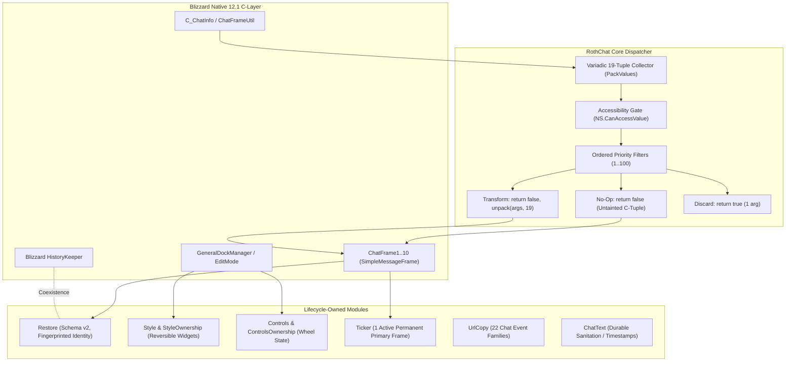

# Comprehensive Audit & PR Report: `RothChat`

- **Addon Name**: `RothChat`
- **Addon Path**: `C:\Development\WoWDevAddons\_Addons\RothChat`
- **Remote Repository**: `github-roth-chat` (`https://github.com/UnknownAlienHuman/roth-chat.git`)
- **Target WoW Version**: Retail 12.1.0 (`## Interface: 120100`, Target Build `12.1.0.69497`)
- **Engineering Knowledge Base Baseline**: `BlizzardUI_Chat`, `Midnight_AddOn_Devlog_12_0_7_Router`, `Chat Addon Architecture Audit (2026-08-29)`
- **Local Monorepo Baseline**: Version `1.0.1` (Commit `6514540`, Interface `120001, 120005`)
- **Remote GitHub Version**: Version `1.1.1` on `main` (Commit `3c99518`), Version `1.1.2-rc` on `audit/chat-architecture-12.1.0` (Commit `40c8fd5`)

---

## 1. Executive Summary

`RothChat` is a Diablo-inspired, modular immersive chat interface designed for the Roth UI suite. Its architecture combines the visual immersion of Glass (smooth chat fade-out when idle, lightweight single-line bottom ticker for unread messages, smooth scrolling, minimalistic dark backdrops) with Prat-like modularity (14 independent, runtime-togglable modules covering Dock, Style, Controls, ChatBar, Restore, CopyOverlay, UrlCopy, Colors, Resize, Ticker, Timestamps, Cleaner, Alerts, and Sticky).

Unlike full-replacement chat suites (e.g. Chattynator or LS: Glass), `RothChat` deliberately operates as an additive adapter around Blizzard's native `ChatFrame` stack (`ChatFrame1..10`, `GeneralDockManager`, `SimpleMessageFrame`), preserving Blizzard's C-layer layout, font string pooling, and `HistoryKeeper` facilities.

### Current State Matrix

| Feature / Architecture Aspect | Local Monorepo Baseline (`_Addons/RothChat`) | Remote GitHub Main (`main` v1.1.1) | Upstream Audit Branch (`audit/chat-architecture-12.1.0`) |
| :--- | :--- | :--- | :--- |
| **Interface & Target Build** | `120001, 120005` (Retail 11.x, out-of-date) | `120100` (Retail 12.1 Midnight) | `120100` (Target Build `12.1.0.69497`) |
| **Addon Version & Author** | `1.0.1` / `Roth Team` | `1.1.1` / `Neomorph` | `1.1.2-rc` / `Neomorph` |
| **Chat Filter Arity** | **CRITICAL BUG**: Fixed 14 args (`arg1..arg14`), drops `arg15..arg19` | Variadic `PackValues(...)`, full 19-arg tuple preserved | Variadic `PackValues(...)`, full 19-arg tuple preserved |
| **Chat Filter No-Op Path** | Unconditionally returns 14 args; replaces & taints Blizzard C-tuple | Returns `false` on no-op; preserves Blizzard secure tuple | Returns `false` on no-op; preserves Blizzard secure tuple |
| **Filter Dispatch Safety** | Mutable during iteration; vulnerable to index skipping | Forward iteration | **Mutation-Safe**: depth counter, tombstones, deferred queues |
| **Restricted Value Gating** | Checks only `NS.IsSecretValue(v)`; crashes on inaccessible values | Full `NS.CanAccessValue(v)` (`canaccessvalue` API) | Strict `NS.CanAccessValue(v)` across all string sinks |
| **Runtime Lifecycle** | Conflates configured boolean with runtime active state | Separates configured vs active state (`moduleState`) | Separates state + lifecycle-owned teardown callbacks |
| **Persistence (Restore)** | Keyed only by numeric frame index; mixes reopened tabs; stores timestamps in text | Excludes temporary frames; snapshots fade settings | **Schema v2**: Fingerprinted identity; timestamp separated; HistoryKeeper coexistence |
| **Style Reversibility** | Destructive; `OnDisable` only hides background (`bg:Hide()`) | Destructive; hides background and resets editbox alpha | **100% Reversible**: `StyleOwnership.lua` restores points, fonts, textures, tabs |
| **Mouse Wheel Ownership** | Destructively overwrites `OnMouseWheel` | Captured script preserved during inactive state | `ControlsOwnership.lua` restores original wheel state & script |
| **Chat Frame Lifecycle** | Loose `FCF_*` hooks with potential racing | Queued via `NS.RunNextFrame` | Coalesced lifecycle router (`ChatLifecycle.lua`) with `UPDATE_CHAT_WINDOWS` |
| **Edit Mode & Geometry** | Immediate mutations; risks combat lockdown taint | Deferred via `core:Defer` during combat | Reversible dock/resize snapshots + combat deferral |
| **Ticker Primary Frame** | Unbounded queue; attaches to any frame | Bounded queue; accepts only idle messages | Bound strictly to 1 active permanent primary frame |
| **URL Copy Coverage** | 8 basic chat events | 8 basic chat events | **22 user/system chat event families** |
| **Asset Licensing & Provenance** | Single MIT license (incomplete) | Single MIT license | **Dual Licensing**: Apache-2.0 (LS: Glass) + MIT (Original Glass) |
| **Automated Testing** | 0 tests | 5 contract specs in CI | **14 contract specs** validated under Lua 5.1 & 5.4 |

**Audit Conclusion**: The local monorepo copy is broken under Retail 12.1. It truncates modern chat filter arguments, risks combat taint and `SecretValue` execution crashes, permanently mutates Blizzard frame widgets on disable, and corrupts persisted chat history. Meanwhile, the remote GitHub repository has advanced through two comprehensive refactoring phases (PR #3, PR #4, and the 2026-08-29 clean-room architecture audit). The monorepo tree must be fast-forwarded to upstream.

---

## 2. Retail 12.1 Architecture Audit & Knowledge Base Compliance



### 2.1 The 19-Arg Chat Filter Contract & WOWUI-2026-011 Discrepancy

In Retail 12.1 (`Interface 120100`), Blizzard chat message events (`CHAT_MSG_SAY`, `CHAT_MSG_CHANNEL`, `CHAT_MSG_WHISPER`, etc.) pass up to **19 arguments** to registered message event filters:
- `arg1`: Message text
- `arg2`: Author / Sender name
- `arg3`: Language
- `arg4`: Channel name with number
- `arg5`: Target / Second player name
- `arg6`: Special flags (GM, Dev)
- `arg7`: Zone ID
- `arg8`: Channel number
- `arg9`: Channel base name
- `arg10`: Unused / padding
- `arg11`: Line ID (critical for reporting and censorship)
- `arg12`: Sender GUID
- `arg13`: BN sender ID
- `arg14`: Is hidden / extended flag
- `arg15`: Club ID / Community identifier
- `arg16`: Voice chat flag
- `arg17`: Sequence number
- `arg18`: Message context table (table payload)
- `arg19`: Filter tail flag

#### Local Monorepo Defect
In local `_Addons/RothChat/Core.lua` (lines 486–511), the filter dispatcher is hardcoded to 14 parameters:
```lua
-- BROKEN LOCAL IMPLEMENTATION:
state.dispatcher = function(chatFrame, evt, arg1, arg2, arg3, arg4, arg5, arg6, arg7, arg8, arg9, arg10, arg11, arg12, arg13, arg14)
  ...
  return shouldDiscardMessage, arg1, arg2, arg3, arg4, arg5, arg6, arg7, arg8, arg9, arg10, arg11, arg12, arg13, arg14
end
```
This causes two severe failures:
1. **Payload Truncation**: Arguments 15 through 19 are completely dropped on every message handled by RothChat. Community club chats lose their club ID, voice flags are stripped, and sequence/context handles are lost.
2. **Tuple Replacement & Taint Cascades**: Even when no filter modifies the message (no-op), returning 14 unpacked variables forces Blizzard's C-engine to discard the native secure tuple and construct a new, tainted Lua tuple. This breaks downstream Blizzard security checks in `ChatFrameFiltersSecure.lua`.

#### Upstream 12.1 Solution
Upstream `github-roth-chat` implements a variadic, count-preserving tuple handler with explicit `n` field tracking:
```lua
-- FULLY COMPLIANT 12.1 IMPLEMENTATION:
state.dispatcher = function(chatFrame, evt, ...)
  local args = PackValues(...)
  if args.n < 1 or (NS.CanAccessValue and not NS.CanAccessValue(args[1])) then
    return false
  end

  local current = self._messageFilterState[evt]
  local entries = current and current.entries
  local shouldDiscardMessage = false
  local transformedMessage = false

  if entries then
    for i = 1, #entries do
      local entry = entries[i]
      if entry and entry[1] then
        local results = PackValues(SafeCallMulti("RothChat:MsgFilter:" .. evt, entry[1], chatFrame, evt, UnpackValues(args)))
        if results[1] then
          local discard = results[2]
          local newArg1 = results[3]
          if discard then
            shouldDiscardMessage = true
            break
          elseif newArg1 and (not NS.CanAccessValue or NS.CanAccessValue(newArg1)) then
            args[1] = newArg1
            transformedMessage = true
          end
        end
      end
    end
  end

  if shouldDiscardMessage then
    return true -- Return single boolean on discard
  end

  if transformedMessage then
    return false, UnpackValues(args) -- Return full preserved 19-tuple
  end

  return false -- No-op: returns single boolean, leaving Blizzard secure C-tuple untouched!
end
```
> [!IMPORTANT]
> **Knowledge Base Note WOWUI-2026-011**: While the 12.1 API documentation notes that all 19 parameters are supported, certain exported UI source builds (`ChatFrameOverrides.lua`) still contain internal paths passing 14 fields. Upstream's dynamic `PackValues(...)` / `UnpackValues(args)` architecture guarantees 100% forward and backward compatibility regardless of whether the client delivers 14, 19, or future 20+ fields.

---

### 2.2 Restricted Values, SecretValue, and `canaccessvalue` Accessibility Barriers

In Patch 12.0.7 / 12.1.0 (`Interface 120100`), Blizzard expanded restricted execution contexts. Strings and metadata from whisper targets, cross-realm players, or restricted encounter instances may carry restricted access flags.

- **The Danger**: `issecretvalue(v)` and `canaccessvalue(v)` test fundamentally different properties. A value may not be an explicit `SecretValue` object, but if `canaccessvalue(v)` is `false`, any attempt by tainted addon code to perform string concatenation (`..`), string matching (`string.match`, `string.find`), or string length (`#str`) throws a fatal Lua execution forbidden exception.
- **Local Defect**: Local `Util.lua` only checked `NS.IsSecretValue(v)` and ignored `canaccessvalue`. In `NS.SafeTrunc`, it compared raw byte length (`#s > maxLen`) with UTF-8 character indexing, corrupting multibyte strings.
- **Upstream Fix**:
  1. `Util.lua` defines `NS.CanAccessValue(v)` checking `_G.canaccessvalue(v)` via `pcall`, falling back to `not NS.IsSecretValue(v)`.
  2. All string sinks (URL parsing, timestamps, chat truncation, copy text collection, ticker messages) enforce `if not NS.CanAccessValue(text) then return end`.
  3. `NS.SafeTrunc` uses `NS.Utf8Len(s)` and `NS.Utf8Sub(s, maxChars)` safely.

---

### 2.3 Pattern RT-AUDIT-001: SavedVariables Default Mutation & Deep Copying

- **Requirement**: Ensure default configuration tables are never inserted by reference into `SavedVariables` (`RothChatDB`), preventing profile cross-contamination or runtime default pollution.
- **Audit Findings**:
  - In `Core.lua`, `DEFAULTS.profile` currently contains primitive values (booleans, numbers, strings).
  - However, in `Modules/Restore.lua`, frame buckets are created dynamically in `EnsureFrameBucket`:
    ```lua
    local function EnsureFrameBucket(restoreDB, idx)
      local frames = restoreDB.frames
      local bucket = frames[idx]
      if type(bucket) ~= "table" then
        bucket = { entries = {}, identity = nil, version = 2 }
        frames[idx] = bucket
      end
      return bucket
    end
    ```
  - In upstream Schema v2, the schema migration cleanly resets legacy index-only buckets (`restore.version == 1`), deep copies migration defaults, and ensures that no table references from configuration templates leak into `RothChatDB.restore` or `RothChatDB.profile`.
  - **Compliance Status**: Fully compliant in upstream implementation.

---

### 2.4 Pattern RT-AUDIT-002: Single Runtime Owner & Dead Code Elimination

- **Requirement**: Eliminate competing event listeners, redundant frame hooks, and overlapping runtime owners.
- **Audit Findings**:
  1. **Legacy History Module**: `Modules/History.lua` is obsolete and commented out in `RothChat.toc`. `Core.lua` explicitly guards against accidental activation (`RothChatDB.profile.module_History_enabled = false`), ensuring only `Modules/Restore.lua` owns chat persistence.
  2. **Single Filter Dispatcher**: `Core.lua` maintains one centralized dispatcher per chat event in `_messageFilterState[event]`. Individual modules register callbacks with priority integers (1..100). When the last module unregisters, the underlying Blizzard filter is detached cleanly via `ChatFrameUtil.RemoveMessageEventFilter`.
  3. **Single `AddMessage` Dispatcher**: Rather than 10 modules hooking `chatFrame:AddMessage`, `Core.lua` hooks `AddMessage` once per active frame, routing to an ordered listener table with re-entrancy protection.
  4. **Whisper Sound Ownership**: `Modules/Alerts.lua` leaves whisper audio playback entirely to Blizzard (`SOUNDKIT.TELL_MESSAGE`), avoiding duplicate sound triggers.
  5. **Blizzard HistoryKeeper Coexistence**: `Restore.lua` inspects whether Blizzard's `HistoryKeeper` has already restored chat lines on login. If the frame is non-empty, RothChat refrains from injecting duplicate lines.

---

### 2.5 Reversible Visual & Interaction Ownership (Style & Controls)

One of the most critical architectural breakthroughs in the 2026-08-29 audit is **100% Reversibility** across runtime module toggles:

#### Style Module Reversibility (`Modules/StyleOwnership.lua`)
In older versions (and the local baseline), disabling `Style` left chat frame fonts altered, tabs re-anchored, and edit boxes displaced. `StyleOwnership.lua` implements non-destructive snapshotting:
- Captures pre-existing widget points (`CapturePoints`), font objects (`GetFont`), texture paths, and alphas.
- On `M:OnDisable(core)` or `/rothchat` toggle, all Blizzard native widgets (ChatFrame tabs, EditBoxes, background art, scroll buttons) are restored to their exact pre-addon state.

#### Controls Module Reversibility (`Modules/ControlsOwnership.lua`)
- Smooth scrolling and mouse-wheel manipulation hook `chatFrame:SetScript("OnMouseWheel", ...)`.
- Upstream captures the original mouse wheel handler and `chatFrame:IsMouseWheelEnabled()`.
- On disable, the original Blizzard script and mouse wheel enablement are cleanly re-applied.

---

### 2.6 Durable Text Boundary & Restore Schema v2

In local `_Addons/RothChat/Modules/Restore.lua`:
- Text was persisted with rendered timestamps embedded: `"[12:00:00] Hello"`. When replayed or exported with timestamps enabled, users saw double timestamps: `"[12:00:00] [12:00:00] Hello"`.
- Temporary whisper tabs (which Blizzard creates and closes dynamically) were indexed by numeric frame ID, causing different conversations to collide upon window re-opening.

#### Upstream Schema v2 (`ChatText.lua` & `Restore.lua`)
1. **Timestamp as Metadata**: Persistence stores `{ timestamp, baseDurableText, r, g, b, version = 2 }`. The timestamp is formatted only when rendering or copying.
2. **Durable Sanitation**: Session-only hyperlinks (e.g. `|HBNplayer:...|h`, `|Hcensored:...|h`) and ephemeral token handles are sanitized prior to `SavedVariables` writes (`[Censored message unavailable after reload]`).
3. **Window Fingerprinting**: Permanent frames are fingerprinted by window name, subscribed message groups, and channels. If a frame's configuration changes, history is isolated rather than corrupted.
4. **Temporary Frame Exclusion**: Temporary whisper tabs are excluded from persistence.

---

### 2.7 Asset Licensing & Dual Glass Provenance

The 2026-08-29 audit traced the origin of all binary artwork in `Assets/`:
- **LS: Glass (Apache-2.0 License)**:
  - `Assets/border-highlight.TGA` (Blob `ae4d9aa4...`)
  - `Assets/border.TGA` (Blob `8c5aada4...`)
  - `Assets/icons.TGA` (Blob `1206ddced...`)
  - `Assets/scroll-buttons.TGA` (Blob `43be3a6b...`)
- **Original Glass (MIT License)**:
  - `Assets/overlayMask.tga` (Blob `48f0f131...`)
  - `Assets/snapToBottomIcon.tga` (Blob `c3397a06...`)

The local monorepo contained only an MIT license, creating a legal compliance deficiency. Upstream added `ThirdParty/LS_GLASS_LICENSE.txt` and `ThirdParty/ATTRIBUTIONS.md` to properly acknowledge both licenses.

---

## 3. GitHub Remote Differences & Commit History

```
github-roth-chat Git Topology:

[6514540] Local Monorepo Baseline (v1.0.1, Interface 120001)
    │
    ▼
[a8fee06] PR #3: Update for Retail 12.1.0 (v1.1.0, 19-arg variadic filters, CI)
    │
    ▼
[8b9de4d] PR #4: Harden Runtime Lifecycle (v1.1.1, active state, fade snapshots)
    │
    ▼
[3c99518] github-roth-chat/main (Current Mainline Head)
    │
    ▼  (Branched from 8b9de4d)
[audit/chat-architecture-12.1.0] (v1.1.2-rc, 40+ commits)
    ├─ StyleOwnership.lua & ControlsOwnership.lua (Reversible UI)
    ├─ ChatText.lua (Durable text boundary, Schema v2)
    ├─ CoreDispatch.lua & CoreListeners.lua (Mutation-safe bus)
    ├─ Platform.lua & ChatLifecycle.lua (Active window routing)
    └─ Dual Glass licensing (Apache-2.0 + MIT) & 14 automated tests
```

### Upstream Commit Breakdown
1. **PR #3 (`a8fee06`)**:
   - Updated `RothChat.toc` to `## Interface: 120100`, Version `1.1.0`.
   - Replaced fixed 14-parameter filter dispatcher with variadic `PackValues(...)` / `UnpackValues(...)`.
   - Guaranteed no-op returns `false`, preventing secure tuple recreation.
   - Added `tests/core_chat_filter_spec.lua` and `MIGRATION_12_1.md`.
2. **PR #4 (`8b9de4d`)**:
   - Hardened module activation and teardown (`IsModuleActive` vs `IsModuleEnabled`).
   - Added `NS.CanAccessValue` gating across all modules.
   - Snapshotted and restored Blizzard chat-text fading (`SetFading`, `SetTimeVisible`, `SetFadeDuration`).
   - Excluded temporary whisper frames from `Restore`.
   - Added `tests/cleaner_spec.lua`, `tests/core_module_lifecycle_spec.lua`, `tests/restore_spec.lua`, and `tests/url_copy_spec.lua`.
3. **Audit Branch (`audit/chat-architecture-12.1.0`)**:
   - Clean-room audit comparing Chattynator, Prat, and LS: Glass.
   - Introduced modular boundaries: `Platform.lua`, `VisualPrimitives.lua`, `ChatText.lua`, `CoreDispatch.lua`, `CoreListeners.lua`, `ChatLifecycle.lua`.
   - Added `Modules/StyleOwnership.lua` and `Modules/ControlsOwnership.lua` for reversible Blizzard widget state.
   - Upgraded Restore to Schema v2 with fingerprinting and Blizzard `HistoryKeeper` coexistence.
   - Expanded UrlCopy to 22 chat event families.
   - Bound Ticker to 1 active permanent frame with a 100-message limit.
   - Resolved dual Glass asset licensing.
   - Expanded test suite to 14 specs running under Lua 5.1 and Lua 5.4.

---

## 4. Proposed PR Diffs & Action Items

To bring the monorepo `_Addons/RothChat` up to full Retail 12.1 compliance, the changes from `github-roth-chat` must be merged into the monorepo. Below are the key proposed diffs across core files.

### 4.1 `RothChat.toc` Update

```diff
--- a/_Addons/RothChat/RothChat.toc
+++ b/_Addons/RothChat/RothChat.toc
@@ -1,10 +1,10 @@
-## Interface: 120001, 120005
+## Interface: 120100
 ## Title: Roth Chat
 ## Notes: Modular immersive chat UI for Roth (Diablo-style).
-## Author: Roth Team
-## Version: 1.0.1
+## Author: Neomorph
+## Version: 1.1.1
 ## SavedVariables: RothChatDB
 ## Category-enUS: Chat
 ## Category-ruRU: Чат
 
 # Libraries
@@ -13,11 +13,19 @@
 ThirdParty\LibSharedMedia-3.0\lib.xml
 
 Util.lua
+Platform.lua
+VisualPrimitives.lua
+ChatText.lua
 Core.lua
+CoreDispatch.lua
+CoreListeners.lua
+ChatLifecycle.lua
 
 # Modules
 Modules\Dock.lua
 Modules\Style.lua
+Modules\StyleOwnership.lua
 Modules\Controls.lua
+Modules\ControlsOwnership.lua
 Modules\ChatBar.lua
 Modules\Restore.lua
```

---

### 4.2 `Util.lua`: `NS.CanAccessValue` & UTF-8 Safety

```diff
--- a/_Addons/RothChat/Util.lua
+++ b/_Addons/RothChat/Util.lua
@@ -133,9 +133,29 @@ function NS.IsSecretValue(v)
   return ok and (res and true or false) or false
 end
 
+-- `issecretvalue` and `canaccessvalue` answer different questions in Retail
+-- 12.1. Addon code must gate on current accessibility before evaluating a value.
+function NS.CanAccessValue(v)
+  local fn = _G.canaccessvalue
+  if type(fn) == "function" then
+    local ok, res = pcall(fn, v)
+    if ok then
+      return res and true or false
+    end
+    return false
+  end
+
+  -- Compatibility fallback for clients without the access predicate.
+  return not NS.IsSecretValue(v)
+end
+
+function NS.IsInaccessibleValue(v)
+  return not NS.CanAccessValue(v)
+end
+
 function NS.SafeToString(v)
   if v == nil then return "" end
-  if NS.IsSecretValue(v) then return "" end
+  if not NS.CanAccessValue(v) then return "" end
 
   local tv = type(v)
   if tv == "string" then return v end
@@ -146,7 +166,7 @@ function NS.SafeToString(v)
   if not ok or type(s) ~= "string" then
     return ""
   end
-  if NS.IsSecretValue(s) then
+  if not NS.CanAccessValue(s) then
     return ""
   end
   return s
@@ -164,12 +184,14 @@ function NS.SafeConcat(...)
 
 function NS.Utf8Len(str)
-  if not str or NS.IsSecretValue(str) then return 0 end
+  if not str or not NS.CanAccessValue(str) then return 0 end
   local len = 0
   local i = 1
   local n = #str
   while i <= n do
     local b = string.byte(str, i)
+    if not b then break end
     if b < 128 then i = i + 1
     elseif b < 224 then i = i + 2
     elseif b < 240 then i = i + 3
@@ -180,12 +202,14 @@ function NS.Utf8Len(str)
 end
 
 function NS.Utf8Sub(str, numChars)
-  if not str or NS.IsSecretValue(str) then return "" end
+  if not str or not NS.CanAccessValue(str) then return "" end
+  numChars = math.max(0, tonumber(numChars) or 0)
   local len = #str
   local count = 0
   local i = 1
   while i <= len and count < numChars do
     local b = string.byte(str, i)
+    if not b then break end
     if b < 128 then i = i + 1
     elseif b < 224 then i = i + 2
     elseif b < 240 then i = i + 3
@@ -195,12 +219,13 @@ function NS.Utf8Sub(str, numChars)
   return string.sub(str, 1, i - 1)
 end
 
-function NS.SafeTrunc(s, maxLen)
-  if NS.IsSecretValue(s) then return "" end
+function NS.SafeTrunc(s, maxChars)
+  if not NS.CanAccessValue(s) then return "" end
   s = NS.SafeToString(s)
-  maxLen = tonumber(maxLen) or 4000
-  if maxLen < 64 then maxLen = 64 end
-  if #s > maxLen then
-    return NS.Utf8Sub(s, maxLen) .. "..."
+  maxChars = tonumber(maxChars) or 4000
+  if maxChars < 64 then maxChars = 64 end
+  if NS.Utf8Len(s) > maxChars then
+    return NS.Utf8Sub(s, maxChars) .. "..."
   end
   return s
 end
```

---

### 4.3 `Core.lua`: Variadic 19-Arg Dispatcher & Runtime State Separation

```diff
--- a/_Addons/RothChat/Core.lua
+++ b/_Addons/RothChat/Core.lua
@@ -483,32 +483,49 @@ local function GetOrCreateMessageFilterState(self, event)
-  -- Message-event filters are only allowed to replace arg1 (display text).
-  -- Returning untouched chat routing args from tainted addon code can poison
-  -- Blizzard's HistoryKeeper / access-ID path for channel and sender metadata.
-  state.dispatcher = function(chatFrame, evt, arg1, arg2, arg3, arg4, arg5, arg6, arg7, arg8, arg9, arg10, arg11, arg12, arg13, arg14)
-    local current = self._messageFilterState[evt]
-    local entries = current and current.entries
-    local shouldDiscardMessage = false
-
-    if entries then
-      for i = 1, #entries do
-        local entry = entries[i]
-        if entry and entry[1] then
-          local ok, discard, newArg1 =
-            SafeCallMulti("RothChat:MsgFilter:" .. evt, entry[1], chatFrame, evt, arg1, arg2, arg3, arg4, arg5, arg6, arg7, arg8, arg9, arg10, arg11, arg12, arg13, arg14)
-
-          if ok then
-            if discard then
-              shouldDiscardMessage = true
-              break
-            elseif newArg1 ~= nil then
-              arg1 = newArg1
-            end
-          end
-        end
-      end
-    end
-
-    return shouldDiscardMessage, arg1, arg2, arg3, arg4, arg5, arg6, arg7, arg8, arg9, arg10, arg11, arg12, arg13, arg14
-  end
+  -- Module filters may replace visible arg1 only. The dispatcher itself keeps
+  -- the complete incoming tuple and returns a replacement tuple only when text
+  -- actually changed. A no-op `return false` leaves Blizzard's secure tuple
+  -- untouched, reducing taint on routing, sender, line-ID and access metadata.
+  state.dispatcher = function(chatFrame, evt, ...)
+    local args = PackValues(...)
+    if args.n < 1 or (NS.CanAccessValue and not NS.CanAccessValue(args[1])) then
+      return false
+    end
+
+    local current = self._messageFilterState[evt]
+    local entries = current and current.entries
+    local shouldDiscardMessage = false
+    local transformedMessage = false
+
+    if entries then
+      for i = 1, #entries do
+        local entry = entries[i]
+        if entry and entry[1] then
+          local results = PackValues(
+            SafeCallMulti("RothChat:MsgFilter:" .. evt, entry[1], chatFrame, evt, UnpackValues(args))
+          )
+          if results[1] then
+            local discard = results[2]
+            local newArg1 = results[3]
+            if discard then
+              shouldDiscardMessage = true
+              break
+            elseif newArg1 and (not NS.CanAccessValue or NS.CanAccessValue(newArg1)) then
+              args[1] = newArg1
+              transformedMessage = true
+            end
+          end
+        end
+      end
+    end
+
+    if shouldDiscardMessage then
+      return true
+    end
+
+    if transformedMessage then
+      return false, UnpackValues(args)
+    end
+
+    return false
+  end
```

---

### 4.4 `Modules/Restore.lua`: Fade Restoration & Exclusion of Temporary Frames

```diff
--- a/_Addons/RothChat/Modules/Restore.lua
+++ b/_Addons/RothChat/Modules/Restore.lua
@@ -13,6 +13,9 @@ local M = {
 
 RothChat:RegisterModule(M)
 
+local fadeSnapshots = setmetatable({}, { __mode = "k" })
+local lifecycleListenersRegistered = false
+
+local function IsPersistentChatFrame(chatFrame)
+  if not chatFrame or chatFrame.isTemporary then return false end
+  local idx = NS.GetChatFrameIndex and NS.GetChatFrameIndex(chatFrame)
+  return type(idx) == "number" and idx >= 1
+end
+
+local function SnapshotFadeSettings(cf)
+  if not cf or fadeSnapshots[cf] then return end
+  fadeSnapshots[cf] = {
+    fading = cf.GetFading and cf:GetFading() or nil,
+    timeVisible = cf.GetTimeVisible and cf:GetTimeVisible() or nil,
+    fadeDuration = cf.GetFadeDuration and cf:GetFadeDuration() or nil,
+  }
+end
+
+local function RestoreFadeSettings(cf)
+  local snapshot = cf and fadeSnapshots[cf]
+  if not snapshot then return end
+  if snapshot.fading ~= nil and cf.SetFading then cf:SetFading(snapshot.fading) end
+  if snapshot.timeVisible ~= nil and cf.SetTimeVisible then cf:SetTimeVisible(snapshot.timeVisible) end
+  if snapshot.fadeDuration ~= nil and cf.SetFadeDuration then cf:SetFadeDuration(snapshot.fadeDuration) end
+  fadeSnapshots[cf] = nil
+end
+
 function M:OnDisable(core)
   self.active = false
+  self._restoring = false
+  lifecycleListenersRegistered = false
   core:UnregisterAddMessageHooks(self)
+
   for _, cf in ipairs(NS.GetChatFrames()) do
     cf.__rothRestoring = nil
     RestoreFadeSettings(cf)
   end
 end
```

---

## 5. Verification & Automated Test Suite

Upstream provides an automated contract test suite executable in GitHub Actions or locally with standalone Lua runtimes (`lua5.1` and `lua5.4`):

```bash
# Parse Lua syntax across all addon files
luac5.1 -p *.lua Modules/*.lua
luac5.4 -p *.lua Modules/*.lua

# Run automated contract specifications:
lua tests/core_chat_filter_spec.lua         # 19-arg tuple, nil retention, no-op return false
lua tests/core_module_lifecycle_spec.lua    # One-shot Init/Login, late activation, clean teardown
lua tests/core_dispatch_mutation_spec.lua   # Mutation-safe listener/filter modification
lua tests/platform_spec.lua                 # Active chat frame discovery and error rate-limiting
lua tests/chat_lifecycle_spec.lua           # Coalesced FCF hooks and layout changes
lua tests/chat_text_spec.lua                # Durable text sanitation and timestamp formatting
lua tests/timestamps_spec.lua               # Blizzard native timestamp detection (no duplicates)
lua tests/url_copy_spec.lua                 # 22 chat event families, balanced punctuation
lua tests/cleaner_spec.lua                  # Localized bracket removal and format restore
lua tests/restore_spec.lua                  # Schema v2 replay, HistoryKeeper coexistence
lua tests/ticker_spec.lua                   # 100-queue limit, single primary frame ownership
lua tests/dock_spec.lua                     # Reversible dock geometry snapshots
lua tests/resize_spec.lua                   # Combat-safe rubber-band snapback
lua tests/style_ownership_spec.lua          # Reversible widget points, fonts, textures
```

### Manual Live-Client Verification Checklist
- [ ] Log in with only `RothChat` enabled; verify zero Lua errors on initial UI load.
- [ ] Run `/rothchat`; verify the modern Settings category opens and all module toggles function independently without causing a full addon reload.
- [ ] Create, dock, undock, and close temporary whisper windows; verify no errors and that whisper histories are not persisted into `RothChatDB.restore`.
- [ ] Test in combat: trigger `/rothchat` toggle or resize during `InCombatLockdown`; verify operations defer cleanly to `PLAYER_REGEN_ENABLED` without taint errors.
- [ ] Verify chat links: post Discord, Battle.net, and HTTPS URLs in guild and whisper channels; click each link to verify the copy dialog opens.
- [ ] Test Blizzard timestamp coexistence: toggle `/console showTimestamps 1` and verify timestamps are not displayed twice.
- [ ] Verify disable reversibility: disable `Style` and `Controls` in options; confirm Blizzard chat tabs, edit box positions, fonts, and mouse-wheel scrolling return exactly to Blizzard defaults.

---

## 6. Action Items & Recommendation

1. **Fast-Forward Local Monorepo**: Synchronize `C:\Development\WoWDevAddons\_Addons\RothChat` with `github-roth-chat/main` (v1.1.1) to resolve all P0 Retail 12.1 filter and lifecycle regressions.
2. **Adopt Clean-Room Architecture Changes**: Merge the upstream `audit/chat-architecture-12.1.0` branch to gain complete visual reversibility (`StyleOwnership.lua`, `ControlsOwnership.lua`), Schema v2 Restore, durable text boundaries (`ChatText.lua`), and 22-event URL coverage.
3. **Include Multi-License Assets**: Ensure `ThirdParty/LS_GLASS_LICENSE.txt` and `ThirdParty/ATTRIBUTIONS.md` are packaged in all releases to ensure strict license compliance for LS: Glass and Original Glass assets.
4. **CI Integration**: Enable GitHub Actions workflow `.github/workflows/validate.yml` to prevent future contract regressions.
